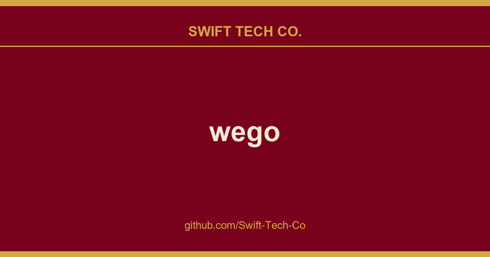

# wego

## What This Is

This is part of the Swift Tech Co. working stack for product and engineering. It gathers the wego notes, examples and fixes that keep delivery fast, and doubles as the reference map we hand to whoever picks up this thread next.

## Images

[](https://github.com/Swift-Tech-Co/wego)

## Features

* show forecast for 1 to 7 days
* multiple backends: `openweathermap`, `weatherapi`, `open-meteo`, `smhi`, `caiyun`, `worldweatheronline`, `pirateweather`, and `json`
* multiple frontends: `ascii-art-table` (default), `emoji`, `markdown`, and `json`
* displayed info:
  * temperature range (felt and measured)
  * windspeed and direction
  * viewing distance
  * precipitation amount and probability
  * humidity
* unit systems: `metric`, `imperial`, `si`, `metric-ms`
* disk caching of weather data with configurable TTL (`--cache-ttl`)
* multi language support
* config file for default location which can be overridden by commandline
* automatic config management with ingo
* built-in man page (`wego --man`)
* composable via JSON: pipe data between the `json` backend and `json` frontend

## Dependencies

* A working Go
  1.20 environment
* utf-8 terminal with 256 colors (for `ascii-art-table` and `emoji` frontends)
* A monospaced font containing all the required runes (e.g. `dejavu sans mono`)
* An API key for most backends (see Setup below; `open-meteo` and `smhi` are free and keyless)

## Installation

Check your distribution for packaging:

[](https://github.com/Swift-Tech-Co/wego)

To directly install or update the wego binary from Github into your `$GOPATH` as usual, run:
```shell
go install github.com/schachmat/wego@latest
```

## Setup

0. Run `wego` once. You will get an error message, but the `wegorc` config file
   will be generated in your `$XDG_CONFIG_HOME/wego/` directory (or the
   OS-equivalent location returned by
   `os.UserConfigDir()`, e.g.
   `~/.config/wego/wegorc` on Linux).
0. Choose a backend and configure it (see below). Then run `wego` again.
0. You may want to adjust other preferences like `days`, `units` and `…-lang` as
   well. Save the file.
0. Run `wego` once again and you should get the weather forecast for the current
   and next few days for your chosen location.
0. If you're visiting someone in e.g. London over the weekend, just run `wego 4
   London` or `wego London 4` (the ordering of arguments makes no difference) to
   get the forecast for the current and the next 3 days.

The config file is resolved in the following order:
1. `$WEGORC` environment variable (highest precedence).
2. `$XDG_CONFIG_HOME/wego/wegorc` (or OS equivalent via `os.UserConfigDir()`), if it exists.
3. `$HOME/.wegorc` (legacy location, for backward compatibility), if it exists.
4. If none of the above exist, a new config file is created at `$XDG_CONFIG_HOME/wego/wegorc`.

### Backends

__Open-Meteo__  free, no API key required:
```
backend=openmeteo
location=New York
```

__SMHI__  free, no API key required (Sweden and surrounding areas):
```
backend=smhi
location=59.33,18.07
```

__Openweathermap__  free API key available:
* Sign up for a free API key.
```
backend=openweathermap
location=New York
owm-api-key=YOUR_OPENWEATHERMAP_API_KEY_HERE
```

__WeatherAPI__  free API key available:
* Sign up for a free API key.
```
backend=weatherapi
location=New York
weather-api-key=YOUR_WEATHERAPI_API_KEY_HERE
```

__Caiyun__  API key required (China-focused, supports Chinese):
```
backend=caiyun
location=121.47,31.23
caiyun-api-key=YOUR_CAIYUN_API_KEY_HERE
```

__Worldweatheronline__  no longer offers free API keys (#83):
```
backend=worldweatheronline
location=New York
wwo-api-key=YOUR_WORLDWEATHERONLINE_API_KEY_HERE
```

__Pirateweather__  free API key available (requires lat,lon location):
* Sign up for a free API key.
```
backend=pirateweather.net
location=40.71,-74.01
pirateweather-api-key=YOUR_PIRATEWEATHER_API_KEY_HERE
```

__JSON file__  read weather data from a local JSON file (useful for testing or offline use):
```
backend=json
location=/path/to/weather.json
```

## Frontends

Select a frontend with the `--frontend` flag or by setting `frontend=…` in `.wegorc`.

| Frontend | Description |
|---|---|
| `ascii-art-table` | Default. Classic colored ASCII art table. |
| `emoji` | Compact emoji-based display. |
| `markdown` | Markdown table output. |
| `json` | JSON output, suitable for piping to other tools. |

Example: `wego --frontend emoji London`

### Color Configuration

Both `ascii-art-table` and `emoji` frontends display temperatures and wind
speeds in color by default. To disable colors:

* Pass `--monochrome` as a flag, or add it to `.wegorc` to make it permanent:
  ```
  monochrome=true
  ```
* Set the `NO_COLOR` environment variable (see no-color.org)
  to disable colors without changing the config:
  ```shell
  NO_COLOR=1 wego
  ```

---

## Swift Tech Co.

Built and maintained by Swift Tech Co.

AI Automation | FinTech Platforms | Custom Software and Mobile Apps | SaaS Platforms | Cloud Infrastructure | Cybersecurity | SEO and Marketing | API Integration

**Join our community on Telegram:** [t.me/+Qt_eFvkb2rliMzNh](https://t.me/+Qt_eFvkb2rliMzNh)

Home | Services | Careers | Referral Program | Influencers | About | Contact

**Connect**

- Website: https://github.com/Swift-Tech-Co/wego
- LinkedIn: [linkedin.com/in/stephenoladoke](https://www.linkedin.com/in/stephenoladoke/)
- LinkedIn (Company): [linkedin.com/company/swift-tech-co](https://www.linkedin.com/company/swift-tech-co)
- X: [@MrOladoke](https://x.com/MrOladoke)
- Instagram: [@mr.oladoke](https://www.instagram.com/mr.oladoke/)
- Instagram (Company): [@swifttechco](https://www.instagram.com/swifttechco/)
- Organization: [github.com/Swift-Tech-Co](https://github.com/Swift-Tech-Co)

## Sources

Compiled and maintained from upstream [schachmat/wego](https://github.com/schachmat/wego) under permissive open-source license.

---

Maintained by [Swift Tech Co.](https://github.com/Swift-Tech-Co) - [Telegram](https://t.me/+Qt_eFvkb2rliMzNh)

## Sources

Compiled and maintained from upstream [schachmat/wego](https://github.com/schachmat/wego) under permissive open-source license.

---

Maintained by [Swift Tech Co.](https://github.com/Swift-Tech-Co) - [Telegram](https://t.me/+Qt_eFvkb2rliMzNh)